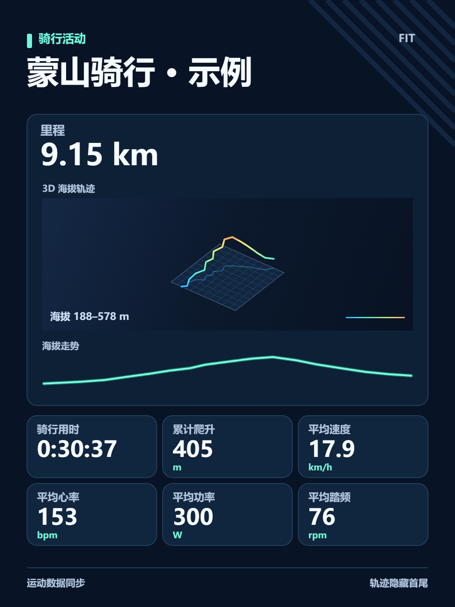

# Sports Data Sync Web · 骑行数据同步

Sports Data Sync Web 是一个可自托管的骑行数据工作台，支持 Garmin Connect（佳明中国区和国际区）及多个运动平台之间的活动同步，也能把 FIT / GPX 原文件保存在电脑或 NAS 上。

打开「轨迹工具」，可以看骑行地图和 3D 海拔、对比同路线骑行、回顾年度纪录和月度热图，还能收藏喜欢的路线并记下补水点与路况。支持 Windows 本机运行和 Docker Compose 部署，已在 Unraid 上安装验证。

[骑行轨迹功能](#骑行轨迹与分析) · [详细使用说明](docs/使用说明.md) · [项目情况说明](docs/情况说明.md) · [升级记录](CHANGELOG.md) · [平台接入范围](#平台接入范围) · [部署与升级](#部署与升级) · [致谢](#致谢)

## 同步骑行活动

- **佳明跨区同步**。分别连接佳明中国区和国际区，可将任一区域设为来源或目标。两步验证在佳明官网完成。部署时请按使用说明选择适用的授权方式。
- **FIT / GPX 原文件**。可以从来源下载、导入已有文件，或一次发送到多个目标。工作台记录各目标的发送状态，跳过已确认或待核对的活动。佳明导入可按目标活动 ID 回查。
- **全量历史和定时增量**。在「数据同步」选择来源和目标后，点「设置全量骑行同步」。首次逐页扫描来源开放的历史，只发送识别为骑行的活动。后续仍会检查列表，传输新增和可重试的记录。

## 骑行轨迹与分析

「轨迹工具」按页列出活动日期、骑行用时、里程、平均功率、平均心率、平均速度和累计爬升。点击表头可排序当前页。单选进入骑行分析，多选可以预览、叠加或合并轨迹。

分析页可主动加载 MapLibre 真实地图，用速度或功率给轨迹着色。带连续海拔数据的活动还可以生成可旋转的 **3D 海拔轨迹**，在全窗口查看，单独导出 PNG，或嵌入骑行战报。

战报支持 3:4 和 9:16，默认隐藏路线和日期。显示路线时，可以选择完整轨迹或裁去起终点附近，再下载 PNG 或通过受支持的浏览器分享。

- **24 套分享图主题**。用自己的 FIT / GPX 预览并导出路线贴纸、骑行唱片、山地积木、月历等版式。[查看全部效果图](docs/使用说明.md#24-套分享图主题效果)
- **同路线对比**。选两趟骑行，叠加路线和海拔曲线，查看用时、爬升、心率和功率。路线方向和计时口径一致时，显示用时差。
- **自动骑行月报与进步分析**。查看当月骑行量、上月变化和新探索格子，自动匹配同方向的历史骑行，比较用时及可用的心率、功率。可免费在本地运行，新增实现与测试采用 [MIT 许可](LICENSE-RIDE-REPORT)。
- **骑行探索地图与月度明信片**。看看这趟新点亮了哪些格子，按月回顾常骑区域的热图，还能把月度统计和代表骑行做成分享图。
- **年度骑行高光**。找出当年的最长距离、单次最高爬升和单次最多探索格子。有连续功率记录时，也能看到最强 5 分钟平均功率。
- **路线收藏与骑行手账**。给路线打上「夜骑」「风景好」「适合带新手」等标签，记下补水点和路况，下次约骑时按标签找回。

## 快速开始

### Windows 本机运行

1. 安装 Node.js 22.13 或更新版本，并准备 Chrome 或 Edge。
2. 在项目目录双击 `start.cmd`。首次运行会安装依赖并构建工作台。
3. 打开 [本机工作台](http://127.0.0.1:8766/)，在「平台账号」连接来源和目标。
4. 到「数据同步」先读一页活动，勾选一条测试下载，再同步到所选目标。

也可在项目目录执行 `npm ci` 和 `npm start`。运行 `npm test` 可执行离线测试。

### Docker Compose 自托管

使用支持 Linux 容器的 Docker 主机和 Compose v2。Unraid、Linux 主机和运行 Linux 容器的 Docker Desktop 可使用同一份 Compose 配置。按手册准备 `.env` 和凭据加密密钥，再运行 `docker compose up -d --build`。个人版首次打开时创建工作台账号。邀请制由管理员生成注册链接，各账号的数据独立保存。

主机本机试用、Unraid 内网访问和佳明授权所需的 HTTPS 配置见 [部署与使用手册](docs/使用说明.md)。

## 平台接入范围

| 能力 | 平台 |
| --- | --- |
| 读取与上传 | 佳明中国区 / 国际区、iGPSPORT 中国区 / 国际区、行者、迈金、黑鸟单车、高驰中国区 / 国际区、Intervals.icu、Wahoo、Suunto、Komoot、[CyCity（骑行 App）](https://apps.apple.com/cn/app/cycity/id6753126988) |
| 读取活动 | 百锐腾、MyWhoosh、Zwift |
| 读取与手动导入 | Keep 可读取带 GPS 的骑行，作为目标时下载 FIT 后到 Keep App 导入 |
| 上传 | 捷安特、Outbase |
| 训练课表 | 从 Intervals.icu 下载计划 FIT，推送兼容课表到 iGPSPORT 中国区 / 国际区或百锐腾国际区 |
| 本机文件 | FIT / GPX 导入、归档、下载和转存 |

活动的读取、下载和上传权限取决于平台与当前账号。部分目标只返回接收回执，工作台会将它与已确认结果区分。各平台的接入步骤和限制见 [详细使用说明](docs/使用说明.md)。

## 部署与升级

Docker 卷保存工作台账号、原始活动文件、任务和同步回执。平台凭据使用单独的密钥加密。升级前备份数据卷、密钥和部署配置，保留同一个 Compose 项目及其挂载，再执行 `docker compose up -d --build`。Windows 版本更新源码后执行 `npm ci`，随后重新启动。

3D 海拔轨迹和战报 PNG 在浏览器内绘制。主动开启真实地图时，浏览器向地图服务请求当前区域的地图瓦片。 [OpenFreeMap](https://openfreemap.org/) · [Mapterhorn](https://mapterhorn.com/)

## 致谢

感谢以下项目的维护者和贡献者。

### 功能与实现参考

感谢伟大的AI让技术平权。
- [鸡翅幸哲迈进OB（Android）](https://github.com/Anathleticbicyclist/sports-data-sync-multiplatform)：同步流程和部分平台的请求格式参考了这个项目。`fit-coordinate.mjs` 的坐标转换改编自其 [FitGcj02Fixer.kt](https://github.com/Anathleticbicyclist/sports-data-sync-multiplatform/blob/38204ab682e5169bbb2af78974fc3c802fcbafe1/app/src/main/java/com/jichi/ob/util/FitGcj02Fixer.kt)。
- [DailySync](https://github.com/gooin/dailysync-rev) 和 [garmin-connect-cn](https://github.com/gooin/garmin-connect-cn)：用于对照佳明中国区活动列表、原始 FIT 下载和跨区同步。感谢国区客户端的上游 [garmin-connect](https://github.com/Pythe1337N/garmin-connect)。
- [magene-fit-strava-fix](https://github.com/dwmer0308-a11y/magene-fit-strava-fix) 和 [Garth](https://github.com/matin/garth)：Android 项目分别鸣谢了它们的坐标转换算法和佳明登录研究。网页版未引入 Garth。

### 程序依赖

| 项目 | 在本项目中的用途 |
| --- | --- |
| [Vue](https://github.com/vuejs/core)、[Element Plus](https://github.com/element-plus/element-plus) | 工作台界面与组件 |
| [Vite](https://github.com/vitejs/vite)、[Vite Vue 插件](https://github.com/vitejs/vite-plugin-vue) | 前端开发与构建 |
| [Garmin FIT JavaScript SDK](https://github.com/garmin/fit-javascript-sdk) | 读取、生成和检查 FIT 文件 |
| [xmldom](https://github.com/xmldom/xmldom) | 读取和生成 GPX 文件 |
| [fflate](https://github.com/101arrowz/fflate) | 解压佳明活动归档和打包 FIT 文件 |
| [bcrypt.js](https://github.com/dcodeIO/bcrypt.js) | 生成高驰登录请求所需的密码哈希 |
| [Playwright](https://github.com/microsoft/playwright) | 浏览器授权辅助 |
| [MapLibre GL JS](https://github.com/maplibre/maplibre-gl-js) | 交互地图与地形渲染 |

[完整 npm 依赖致谢](docs/依赖致谢.md) 按锁文件列出了直接和间接依赖。各依赖适用各自的许可。

### 运行环境与地图数据

- [Node.js](https://github.com/nodejs/node) 和 [npm CLI](https://github.com/npm/cli) 提供运行环境和依赖安装。[Docker Compose](https://github.com/docker/compose) 和 [Node.js 官方容器镜像](https://github.com/nodejs/docker-node) 用于自托管部署。
- [OpenFreeMap](https://github.com/hyperknot/openfreemap) 提供底图瓦片，使用 [OpenMapTiles](https://github.com/openmaptiles/openmaptiles) 的图层规范，地图数据来自 [OpenStreetMap 及其贡献者](https://www.openstreetmap.org/copyright)。[Mapterhorn](https://github.com/mapterhorn/mapterhorn) 提供地形高程瓦片，[数据来源](https://mapterhorn.com/attribution/)由该项目列出。
